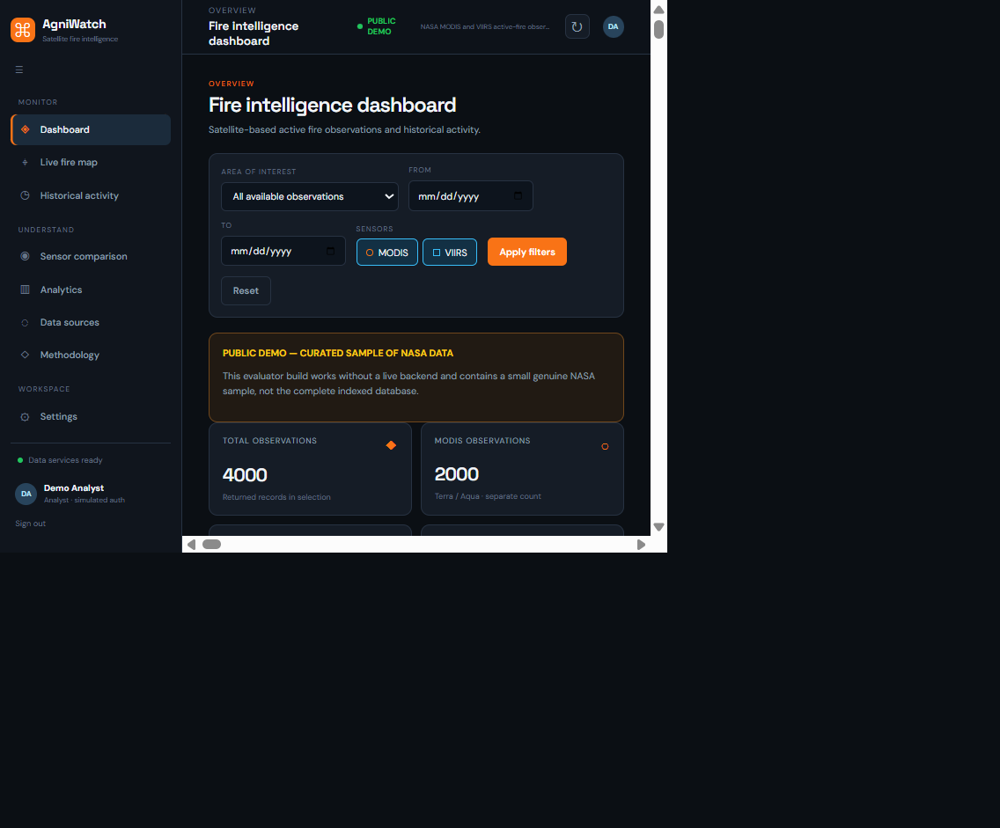
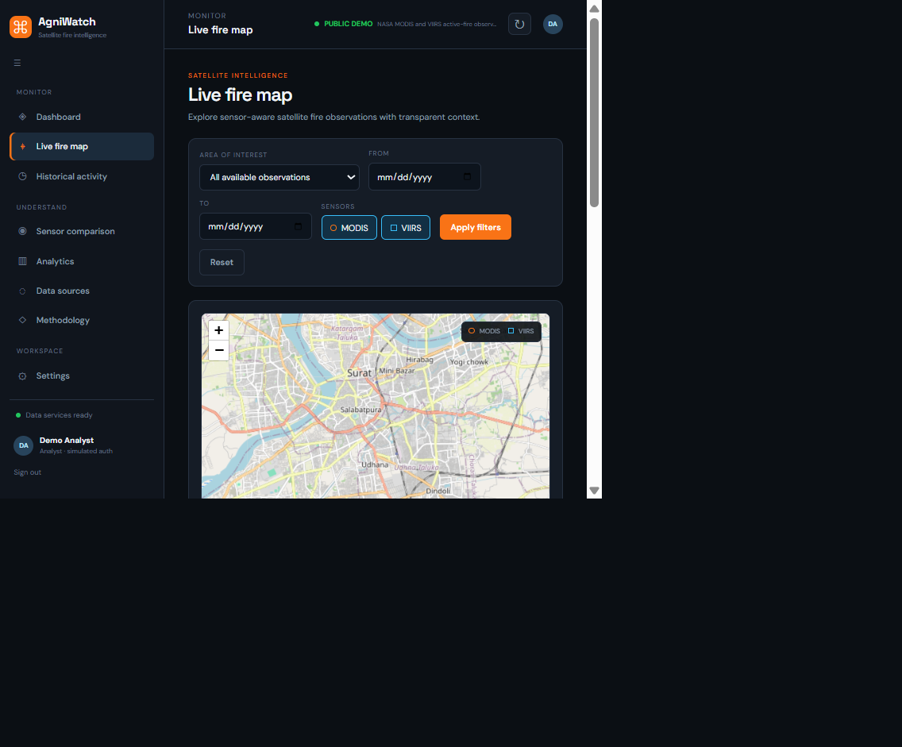
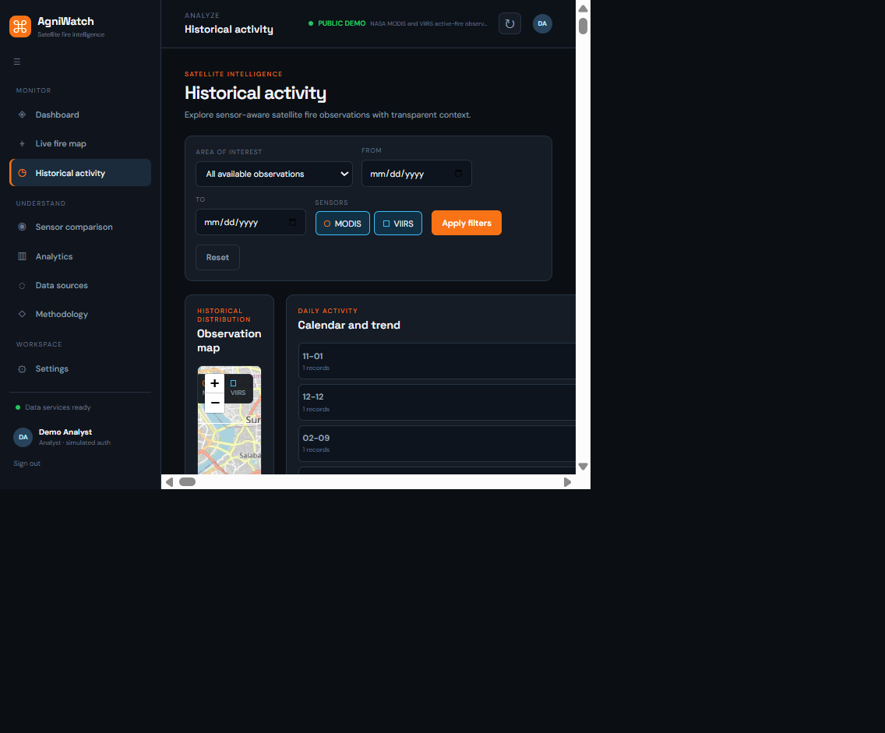
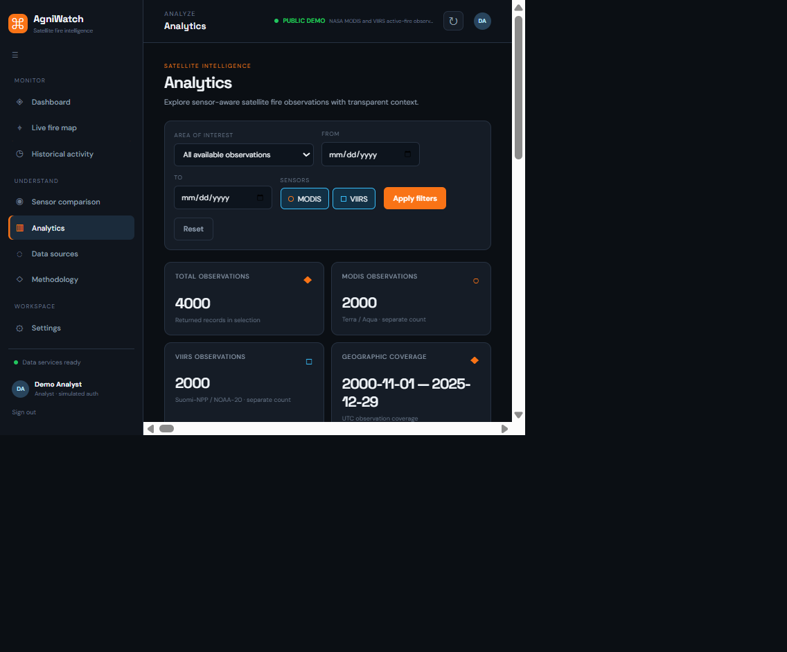
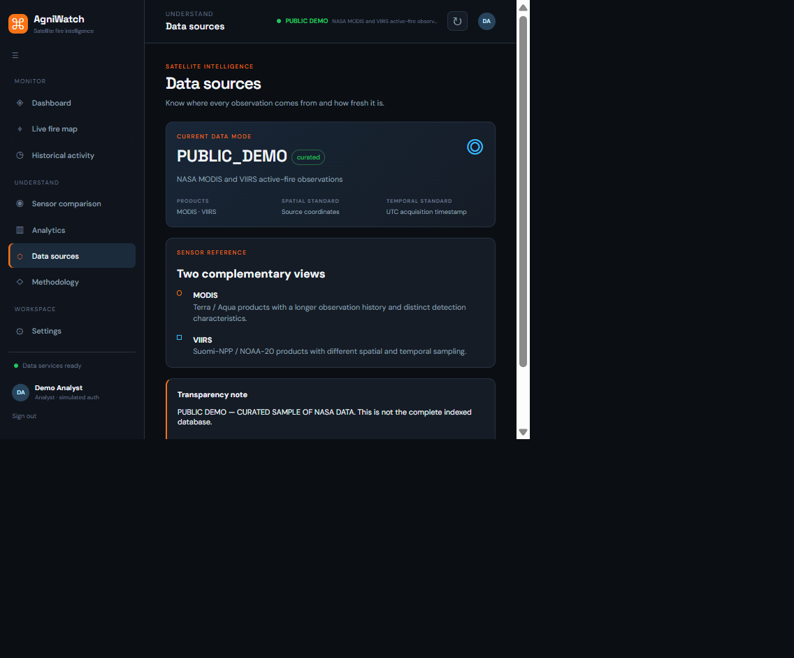
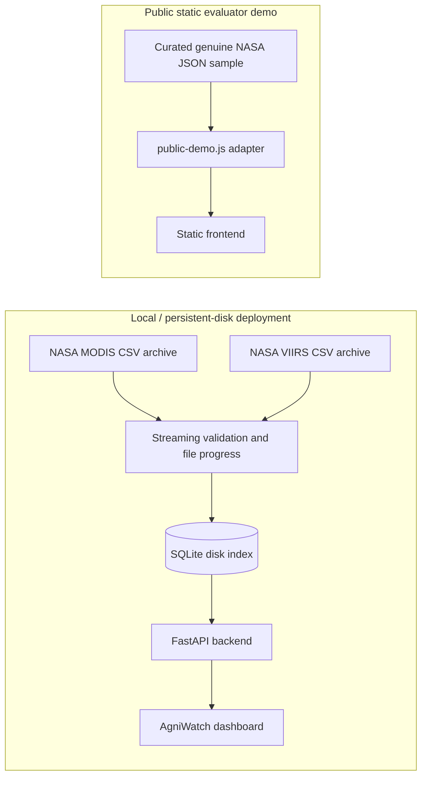

# AgniWatch

## Satellite fire intelligence for MODIS and VIIRS observations

**Team Orbit X · NASA Space Apps Challenge 2026**
Challenge: **Harmonization of MODIS and VIIRS Hot Spots**

[](https://www.python.org/)
[](https://fastapi.tiangolo.com/)
[](https://developer.mozilla.org/en-US/docs/Web/JavaScript)
[](LICENSE)

AgniWatch is an interactive dashboard for exploring active-fire observations from NASA MODIS and VIIRS products. It keeps sensor identity visible, combines geographic and temporal views, and makes data provenance and limitations explicit.

> AgniWatch is an independent NASA Space Apps project. It does not claim NASA endorsement, sponsorship, or affiliation. Observation records are not predictions, fire forecasts, burned-area estimates, or confirmed individual fire events.

## Dashboard preview



The screenshots were captured from the running frontend using the genuine public-demo sample.

| Live fire map | Historical activity |
|---|---|
|  |  |

| Analytics | Data sources |
|---|---|
|  |  |

## Why this matters

Active-fire satellite products provide observations that can help people explore where and when thermal anomalies were recorded. MODIS and VIIRS are complementary, not interchangeable:

- **MODIS** provides a long historical record from Terra and Aqua with distinct spatial resolution and detection characteristics.
- **VIIRS** provides different spatial and temporal sampling from Suomi-NPP and NOAA-20 products.
- Comparing their counts without preserving sensor identity can create misleading conclusions.

AgniWatch therefore presents sensor-specific counts, UTC acquisition timestamps, coordinates, source attributes, and interpretation guardrails rather than collapsing the products into a single “fire intensity” score.

## What AgniWatch provides

- Hash-routed dashboard, live-fire map, historical activity, sensor comparison, analytics, data sources, methodology, settings, and login views.
- Leaflet map with pan/zoom, marker clustering, sensor-distinguishable marker shapes, popups, and selected-record details.
- MODIS/VIIRS filters, UTC date filters, observation lists, charts, activity calendar, summary cards, and CSV export.
- FastAPI endpoints for health, metadata, observations, summary, trends, calendar, methodology, export, and simulated authentication.
- Streaming/paginated SQLite access for the local index instead of loading the archive into RAM.
- Resumable file-by-file indexing with transaction rollback and progress tracking.
- A backend-free `PUBLIC_DEMO` mode for static hosting and evaluator access.

## Public demo

The default static frontend mode is `PUBLIC_DEMO`. It loads [frontend/public_demo_data.json](frontend/public_demo_data.json) through [frontend/public-demo.js](frontend/public-demo.js), so it works without FastAPI or the local database.

The published sample contains exactly:

| Sample | Records |
|---|---:|
| MODIS | 2,000 |
| VIIRS | 2,000 |
| **Total** | **4,000** |

The sample was generated with a read-only SQLite connection and deterministic rowid ranges; the generator does not use `ORDER BY RANDOM()` and does not load the 62 GB database into memory. The JSON includes source labels, timestamps, coordinates, available attributes, summary values, provenance, generation time, and `index_ready: false`.

The public demo supports:

- Map markers and sensor identity.
- MODIS/VIIRS and date filtering.
- Summary cards, trends, calendar aggregation, and observation lists.
- Pagination-compatible observation responses.
- CSV export of the selected sample.
- Methodology and limitation messaging.

It is a curated evaluator sample, not the complete local database. It must not be described as a complete NASA archive or a fully indexed dataset.

### Run the public demo locally

```powershell
cd C:\Users\abhis\AgniWatch\frontend
python -m http.server 5173
```

Open <http://127.0.0.1:5173>. No FastAPI process or database access is required.

To regenerate the sample from the local database, use the read-only tool:

```powershell
cd C:\Users\abhis\AgniWatch
python tools\generate_public_demo.py `
  --database backend\data\agniwatch_local.sqlite3 `
  --output frontend\public_demo_data.json `
  --per-sensor 2000
```

Do not upload the SQLite database or the original NASA archive to static hosting.

## Architecture



The local mode requires persistent storage. The public mode is independent and intentionally limited to the committed static sample.

## Dataset and provenance

### Original source archive

The local NASA archive audit found:

| Dataset | CSV files | Source observations |
|---|---:|---:|
| MODIS | 5,275 | 111,424,417 |
| VIIRS | 3,062 | 281,144,514 |
| **Total** | **8,337** | **392,568,931** |

The source archive occupies approximately **30.86 GB** (`30,864,993,425` bytes). The archive and its CSV files are local-only and excluded from Git.

### Current committed SQLite state

The latest read-only audit of `backend\data\agniwatch_local.sqlite3` reported:

| Sensor | Completed files | Committed observations |
|---|---:|---:|
| MODIS | 5,275 | 111,424,417 |
| VIIRS | 1,007 of 3,062 | 93,953,142 |
| **Total committed** | **6,282** | **205,377,559** |

The database metadata reports `ready=0`. VIIRS indexing is incomplete, so the local deployment is partial. The database is approximately 62 GB and is never included in this repository.

The per-file progress table is the authoritative source for the committed counts above. A stale metadata statistics value for MODIS was observed during the audit; it is not used to describe the public sample.

### Data processing methodology

1. Discover MODIS and VIIRS CSV files recursively.
2. Normalize sensor-specific column names into the shared observation schema.
3. Validate timestamps and coordinate ranges while streaming rows.
4. Insert bounded batches into SQLite transactions.
5. Record completed-file progress only after a successful transaction.
6. Preserve source filename, sensor, timestamp, coordinates, and available attributes.
7. Query through pagination and aggregation rather than retaining the archive in memory.

The dashboard uses UTC dates and preserves sensor identity. Counts represent observation records, not unique fires or intensity.

## Local backend setup

Requirements: Python 3.10 or newer, sufficient disk space for the local SQLite index, and the downloaded NASA archive when using `LOCAL`.

```powershell
cd C:\Users\abhis\AgniWatch\backend
python -m venv .venv
.\.venv\Scripts\Activate.ps1
pip install -r requirements.txt
```

### Public partial-data backend

Use this mode to serve only committed rows without resuming indexing:

```powershell
$env:AGNIWATCH_DATA_MODE = "LOCAL_PARTIAL"
$env:AGNIWATCH_DATA_ROOT = "..\Data"
$env:AGNIWATCH_LOCAL_INDEX = "data\agniwatch_local.sqlite3"
$env:AGNIWATCH_CORS_ORIGINS = "http://127.0.0.1:5173"
uvicorn app.main:app --host 127.0.0.1 --port 8000
```

`LOCAL_PARTIAL` does not rebuild or resume the incomplete index. It reports `PARTIAL`, preserves `ready=0`, and serves committed observations.

### Full local indexing mode

`LOCAL` can build or resume the disk index. It is intentionally not used by the static public demo:

```powershell
$env:AGNIWATCH_DATA_MODE = "LOCAL"
python -c "from app.main import PROVIDER; print(PROVIDER.metadata())"
```

Run only one indexer at a time. Never delete or recreate the database, progress tables, WAL, or source archive.

### Frontend API mode

The static frontend defaults to `PUBLIC_DEMO`. To use FastAPI instead, edit `frontend\config.js`:

```javascript
window.AGNIWATCH_FRONTEND_MODE = "API";
window.AGNIWATCH_API_BASE = "http://127.0.0.1:8000/api";
```

Production API mode requires a public backend URL and matching `AGNIWATCH_CORS_ORIGINS`. Never place a FIRMS key or other secret in frontend JavaScript.

## API reference

FastAPI routes are defined in [backend/app/main.py](backend/app/main.py):

| Route | Purpose |
|---|---|
| `GET /api/health` | Service and data-state health |
| `GET /api/metadata` | Dataset status, provenance, counts, and warnings |
| `GET /api/observations` | Paginated observations with sensor/date/area filters |
| `GET /api/summary` | Sensor counts, date coverage, coordinates, and FRP summary |
| `GET /api/activity-calendar` | UTC day aggregation |
| `GET /api/trends` | Daily MODIS/VIIRS trend points |
| `GET /api/methodology` | Methodology and interpretation limits |
| `GET /api/export` | CSV export |
| `POST /api/auth/login` | Simulated demo authentication |
| `GET /api/auth/me` | Simulated session lookup |
| `POST /api/auth/logout` | Simulated session logout |

Interactive API documentation is available at `/docs` when FastAPI is running.

## Cloudflare Pages readiness

The public demo is prepared for static hosting:

| Setting | Value |
|---|---|
| Framework preset | None |
| Root directory | `frontend` |
| Build command | Empty |
| Build output directory | `.` |

Deploy only the `frontend` directory. The public demo does not depend on localhost, FastAPI, SQLite, the NASA archive, or a build toolchain. The same directory is compatible with the included [frontend/vercel.json](frontend/vercel.json).

The 62 GB SQLite deployment requires a persistent SSD-backed VM or volume-based service; serverless static hosting is not suitable for the backend database.

## Project structure

```text
AgniWatch/
├── backend/
│   ├── app/
│   │   ├── main.py              # FastAPI routes and provider selection
│   │   └── local_data.py        # SQLite index, ingestion, and queries
│   ├── tests/                   # Backend regression tests
│   ├── requirements.txt
│   └── .env.example
├── frontend/
│   ├── index.html
│   ├── app.js                   # Dashboard rendering and interactions
│   ├── api.js                   # Centralized API client
│   ├── public-demo.js           # Static demo adapter
│   ├── public_demo_data.json    # 4,000-record curated sample
│   ├── styles.css
│   └── vercel.json
├── tools/
│   └── generate_public_demo.py
├── docs/
│   └── screenshots/
├── Data/                        # Local-only NASA archive; ignored
└── LICENSE
```

## Testing and verification

Backend regression tests:

```powershell
cd C:\Users\abhis\AgniWatch\backend
$env:AGNIWATCH_DATA_MODE = "DEMO"
python -m unittest discover -s tests -v
```

The existing suite contains 33 tests covering API filtering, summaries, export, authentication behavior, FIRMS parsing/error handling, SQLite normalization, pagination, invalid coordinates, and interruption rollback.

Frontend syntax checks:

```powershell
cd C:\Users\abhis\AgniWatch
Get-ChildItem frontend\*.js | ForEach-Object { node --check $_.FullName }
```

The public sample was verified to contain exactly 4,000 records, evenly split between MODIS and VIIRS, with valid coordinate ranges, no local filesystem paths, and `index_ready=false`.

## Limitations and future work

- The public demo is a 4,000-record sample and is not the full dataset.
- The local VIIRS index is incomplete; the current SQLite state is explicitly partial.
- The full archive and database require persistent local storage and are not published.
- OpenStreetMap tiles and Leaflet assets use external CDNs.
- The login flow is simulated demo authentication, not production identity management.
- No scientifically validated prediction, forecasting, anomaly baseline, or burned-area model is included.
- NASA FIRMS `REAL` mode requires a backend-only `FIRMS_MAP_KEY` and a successful live validation before scientific use.
- Future work includes complete controlled indexing, stronger deployment monitoring, production authentication, and validated analytical baselines.

## Team and acknowledgements

AgniWatch is developed by **Team Orbit X** for the NASA Space Apps Challenge 2026. The project explores the challenge theme “Harmonization of MODIS and VIIRS Hot Spots.”

Acknowledgements:

- NASA FIRMS and NASA Earthdata documentation.
- NASA MODIS and VIIRS active-fire data products.
- FastAPI, Uvicorn, Pydantic, Leaflet, OpenStreetMap contributors, and the open-source ecosystem.

## References

- [NASA FIRMS active-fire data](https://firms.modaps.eosdis.nasa.gov/content/active_fire/)
- [NASA FIRMS area API](https://firms.modaps.eosdis.nasa.gov/api/area/)
- [NASA Earthdata FIRMS guides](https://www.earthdata.nasa.gov/data/tools/firms)
- [MODIS overview](https://modis.gsfc.nasa.gov/about/)
- [VIIRS overview](https://www.nasa.gov/mission_pages/NPP/mission_overview/)

## License

AgniWatch is released under the existing [MIT License](LICENSE).

Project profile: [github.com/ABHISHEKABHI52](https://github.com/ABHISHEKABHI52)
